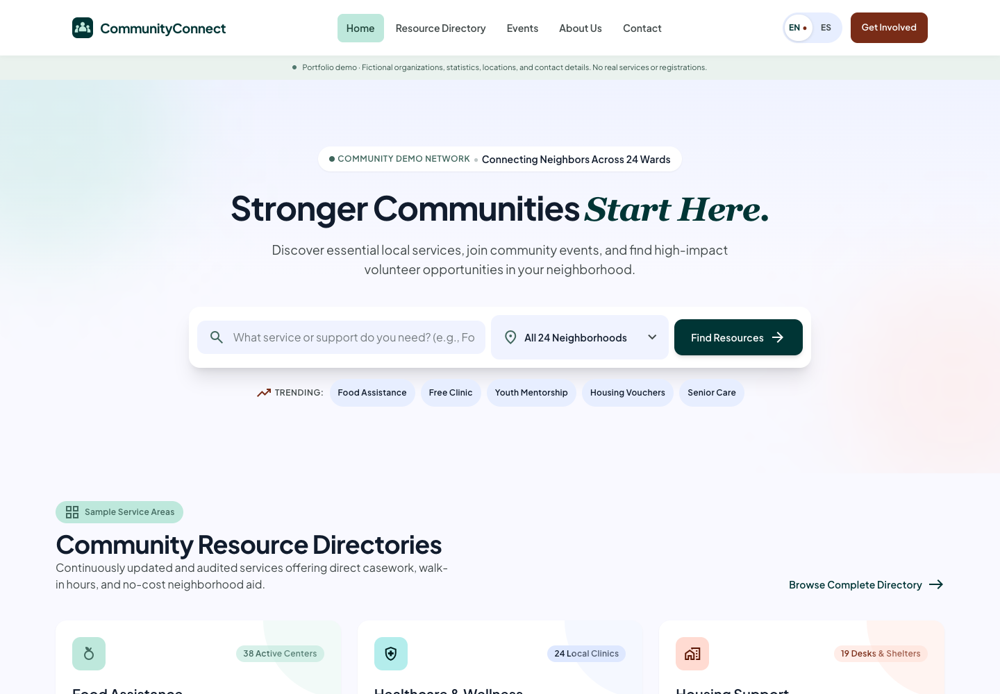

# CommunityConnect

A responsive, bilingual community resource discovery website built with **HTML5, CSS3, and vanilla JavaScript** from the supplied Google Stitch desktop and mobile designs.

Residents can explore sample services, filter community events, try volunteer applications, and use an accessible contact form. The implementation runs entirely in the browser, with no backend or production dependencies.

> **Portfolio demonstration:** Organizations, people, service availability, addresses, phone numbers, statistics, and events are fictional. Form submissions and event registrations are simulations. No message is delivered, appointment booked, service provided, or emergency assistance connected.



## Run locally

**Requirements:** Node.js 20 or newer and a modern browser. Chrome, Edge, Firefox, and Safari support the browser APIs used by this project; automated checks were run in Chrome.

The compiled CSS, images, and fonts are included. You can start the website without installing any packages:

```sh
cd path/to/CommunityConnect
npm start
```

Open **http://127.0.0.1:4173**. Stop the server with `Ctrl+C`.

To use a different port:

```sh
PORT=8080 npm start
```

An alternative, if Python is available, is `python3 -m http.server 4173 --bind 127.0.0.1` from this folder. Use a local HTTP server; opening HTML with `file://` can block JavaScript modules.

## Pages and features

| Page                         | Features                                                                                                                                                                                                            |
| ---------------------------- | ------------------------------------------------------------------------------------------------------------------------------------------------------------------------------------------------------------------- |
| Home — `index.html`          | Resource search with neighborhood selection, category shortcuts, event previews, volunteer pledge, provider links                                                                                                   |
| Resources — `resources.html` | Six data-driven sample resources, live English/Spanish search, category and neighborhood filters, eligibility, distance, service-language filters, sorting, details, share links, illustrative map, printable guide |
| Events — `events.html`       | Eight sample events, category/keyword/month filters, details, simulated registration, grid/calendar/map views, downloadable demo `.ics` files                                                                       |
| About — `about.html`         | Mission, fictional origin story and team, illustrative impact metrics, volunteer application, downloadable sample data                                                                                              |
| Contact — `contact.html`     | Inline validation, accessible error descriptions, local demo confirmation, inquiry preselection, keyboard-operated FAQs                                                                                             |

Shared features include active navigation, an expandable mobile menu, mobile bottom navigation, EN/ES translation, and a saved language preference. The only persistent browser storage is `communityconnect.language` in `localStorage`. Forms do not send or save personal information. Simulated registrations exist in page memory and reset after reload or navigation.

### Try these interactions

1. Search for **food** on Home and select **Northside** to open a matching directory result.
2. On Resources, combine **Within 2 miles** with **Mandarin Support**, then reset the filters.
3. Toggle **ES**, search **despensa**, and open the Spanish resource details.
4. On Events, select **December 2026** to see the empty state; reset and explore the November calendar.
5. Register for a demo event and download its calendar file. The confirmation explicitly says that no place is reserved.
6. Submit an empty contact form, correct the highlighted fields, and see the local demo confirmation.

## Design fidelity

The supplied archive contains ten HTML/screenshot exports—desktop and mobile versions of all five pages—and a shared `DESIGN.md`. Their deep teal, sage, terracotta accents, pale surfaces, typography, card structure, imagery, content sections, spacing, and desktop layouts were retained.

Mobile layouts follow the mobile references with serif headings, compact two-column service categories, a dark impact section, stacked content, and bottom navigation. Intermediate widths use fluid layouts and responsive grid breakpoints.

Necessary adaptations:

- The exported broken logo is replaced with a local civic/community SVG mark.
- Remote Tailwind runtime styling is compiled into a local CSS file. Tailwind is a **development-only CSS compiler**; there is no framework or JavaScript runtime dependency.
- Fonts and usable reference images are stored locally. No external font, image, map, analytics, or styling request is required at runtime.
- Broken placeholder links, nested main landmarks, inert controls, misleading submission alerts, and unsupported certification claims were corrected.
- Sample events use a consistent fictional November 2026 schedule. December deliberately demonstrates an empty month.
- Maps are interactive illustrations of fictional locations, explicitly labeled as unsuitable for navigation.

The original `stitch_communityconnect_platform.zip` remains unchanged. Extracted copies are retained in `design-reference/` for comparison. Asset origins are recorded in `scripts/asset-manifest.json`.

## Project structure

```text
Proj1/
├── index.html / resources.html / events.html / about.html / contact.html
├── css/
│   ├── input.css             # CSS compiler entry
│   ├── stitch.css            # Compiled original design utilities
│   ├── styles.css            # Shared components, accessibility, responsive layouts
│   └── fonts.css             # Local font definitions
├── js/
│   ├── app.js                # Application initialization and Home search
│   ├── data.js               # Structured fictional resources and events
│   ├── cards.js              # Escaped, reusable card renderers
│   ├── filters.js            # Pure search/filter/sort functions
│   ├── resources.js           # Directory state, rendering, map, print guide
│   ├── events.js             # Event filters and calendar rendering
│   ├── forms.js              # Validation and local demo confirmations
│   ├── ui.js                 # Navigation, accessible dialogs, share/download actions
│   ├── i18n.js               # Translation and guarded localStorage persistence
│   └── locales/es-extra.js   # Additional Spanish editorial text
├── assets/
│   ├── favicon.svg
│   ├── images/               # Local Stitch imagery
│   └── fonts/                # Plus Jakarta Sans and Material Symbols
├── scripts/                  # Local server, packaging, screenshot tooling, asset origins
├── tests/                    # Logic, browser interaction, and accessibility checks
├── docs/                     # Test reports and actual browser screenshots
├── design-reference/         # Extracted design copies; not deployed
├── stitch_communityconnect_platform.zip  # Original export; not deployed
├── tailwind.config.cjs
└── package.json
```

## Development

Install the development tooling:

```sh
npm ci
```

Recompile the CSS after changing utility classes in HTML or JavaScript:

```sh
npm run build
```

Edit structured sample records in `js/data.js`, card markup in `js/cards.js`, and shared presentation in `css/styles.css`. Use stable resource/event IDs so shared links continue to work. Add Spanish translations alongside new interface text in the locale catalog. The search normalizes accents and supports English and Spanish content and service aliases.

Translation updates preserve form input and filter state. Storage failures, such as restricted private browsing, fall back to an in-memory language choice. Dynamic catalog content is escaped before rendering; search queries and form input are not interpolated into HTML.

## Testing

Run the pure filtering/data regression tests:

```sh
npm test
```

With the local server running in a second terminal, run the browser checks:

```sh
npm run test:browser
npm run test:a11y
npm run test:extra
```

Browser checks use the installed Google Chrome by default. If Chrome is unavailable, install Playwright Chromium and select it:

```sh
npx playwright install chromium
PLAYWRIGHT_CHANNEL=chromium npm run test:browser
PLAYWRIGHT_CHANNEL=chromium npm run test:a11y
```

The suite checks links, local assets, active navigation, search, combined filters, empty states, keyboard dialog behavior, demo registration, calendar downloads, translations and persistence, form validation, FAQs, printing, and overflow at **1440px** on desktop and in both languages at **360, 390, 768, and 1024px**. Results are saved in `docs/browser-test-results.json`. Accessibility checks use axe-core; results are saved in `docs/accessibility-audit.json`.

Automated checks support review but do not constitute formal WCAG certification or manual screen-reader testing. Cross-browser behavior outside the tested Chrome environment has not been independently verified.

Latest local verification: **12 logic tests**, **24 browser checks**, and **4 additional share/download/routing checks** passed. Axe reported **zero WCAG A/AA violations across 12 desktop, mobile, and dialog scenarios**. The packaged five-page website also passed a local smoke test. Test reports are retained in `docs/`.

To refresh the real browser screenshots, run `npm run screenshots` with the server running.

## Screenshots

| Page      | Desktop                                             | Mobile                                             |
| --------- | --------------------------------------------------- | -------------------------------------------------- |
| Home      | [Full page](docs/screenshots/index-desktop.png)     | [Full page](docs/screenshots/index-mobile.png)     |
| Resources | [Full page](docs/screenshots/resources-desktop.png) | [Full page](docs/screenshots/resources-mobile.png) |
| Events    | [Full page](docs/screenshots/events-desktop.png)    | [Full page](docs/screenshots/events-mobile.png)    |
| About     | [Full page](docs/screenshots/about-desktop.png)     | [Full page](docs/screenshots/about-mobile.png)     |
| Contact   | [Full page](docs/screenshots/contact-desktop.png)   | [Full page](docs/screenshots/contact-mobile.png)   |

[Spanish resource directory](docs/screenshots/resources-spanish.png)

## Deployment

This project has **not been pushed or deployed**.

Generate a static hosting folder:

```sh
npm ci
npm run package
```

The repository includes a `vercel.json` (build `npm run package`, output `dist`). Upload the **contents of `dist/`** to a static hosting service. Its root must contain `index.html` and the other four HTML pages, with the `assets/`, `css/`, and `js/` directories beside them. No SPA rewrite, backend, API keys, environment variables, or serverless functions are needed. Relative paths support hosting under a project subdirectory.

For a host that builds from a repository, set the build command to `npm run package` and the publish/output directory to `dist`. For manual upload hosting, select the generated `dist` folder. For GitHub Pages, publish the generated static output using your chosen Pages workflow. Review and authorize repository creation, pushes, or deployment separately.

### Deploy to Vercel

1. Push this project to a Git repository (the large Stitch ZIP and `design-reference/` are git-ignored on purpose).
2. In Vercel choose **Add New → Project** and import the repository. `vercel.json` already sets Framework **Other**, install `npm ci`, build `npm run package`, and output directory `dist`; no environment variables are required.
3. Or from the CLI: `npx vercel` (preview) and `npx vercel --prod`. Both require your own Vercel login.

Only public site files are copied to `dist/`. The export ZIP, design references, development dependencies, caches, tests, and reports are excluded. Keep the demo notices when sharing this portfolio; connecting real services would require verified data, production forms, and real registration infrastructure.

## Credits

Designs and imagery originate from the Google Stitch export supplied for this project. Typography uses Plus Jakarta Sans and Material Symbols; mobile headings use a system serif matching the mobile reference. Original third-party assets retain their respective licensing terms.
